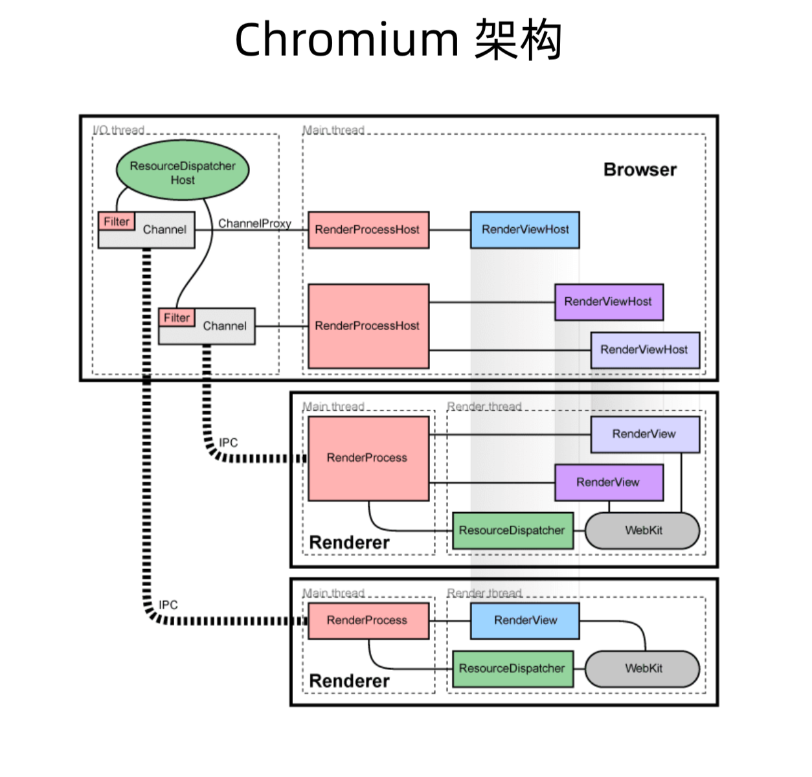
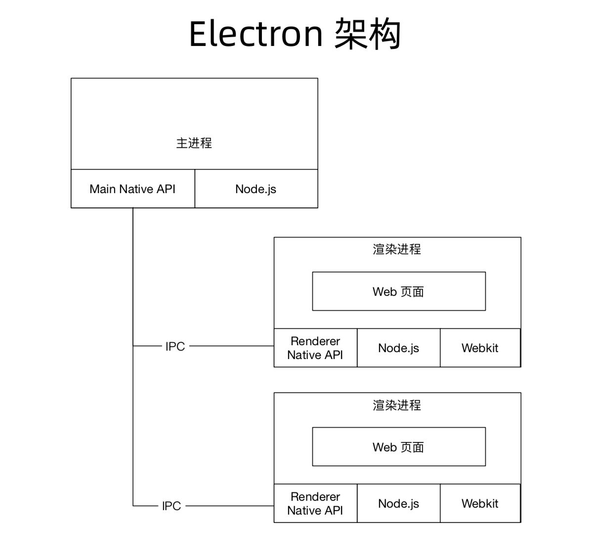
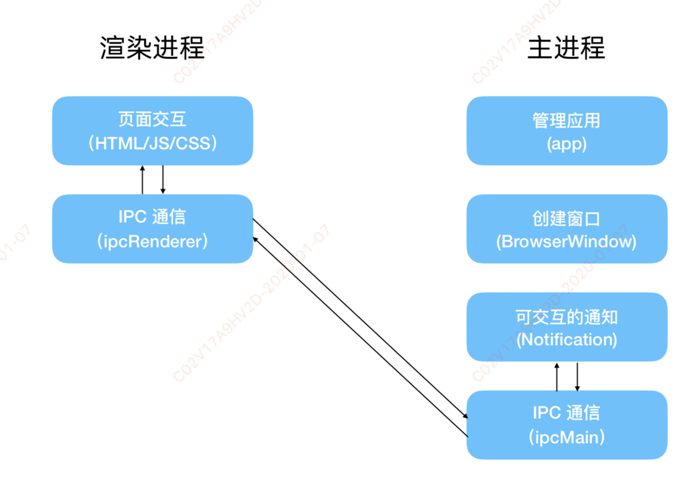
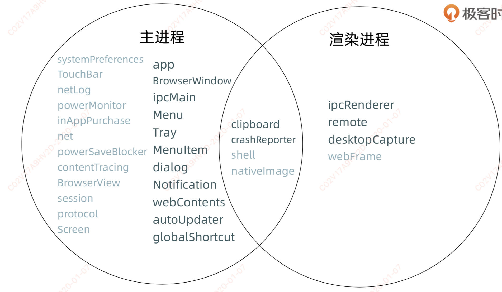

# electron-learn

**Read this in other languages: [English](README.md) | [简体中文](README.zh-CN.md)**

Official Website: https://electronjs.org/

- [electron-learn](#electron-learn)
  - [1. Project Function Points](#1-project-function-points)
    - [Currently Supported Function Points](#currently-supported-function-points)
    - [Usage](#usage)
  - [2. Installation of Electron-related Software](#2-installation-of-electron-related-software)
    - [nvm Installation](#nvm-installation)
    - [Node.js/NPM Installation](#nodejsnpm-installation)
    - [Node Installation Acceleration](#node-installation-acceleration)
    - [Electron Installation](#electron-installation)
    - [Electron Acceleration Tips](#electron-acceleration-tips)
    - [Common Issues](#common-issues)
  - [3. Electron Principles](#3-electron-principles)
    - [2.1. Using Electron's API](#21-using-electrons-api)
    - [3.2. Using Node.js's API](#32-using-nodejss-api)
  - [4. Common Electron APIs](#4-common-electron-apis)
    - [4.1. app](#41-app)
    - [4.2. BrowserWindow](#42-browserwindow)
    - [4.3. ipcMain and ipcRenderer](#43-ipcmain-and-ipcrenderer)
    - [4.4. Menu/MenuItem (Menu/Menu Item)](#44-menumenuitem-menumenu-item)
    - [4.5. Tray](#45-tray)
    - [4.6. clipboard](#46-clipboard)
    - [4.7. screen](#47-screen)
    - [4.8. globalShortcut](#48-globalshortcut)
    - [4.9. desktopCapturer](#49-desktopcapturer)
    - [4.10. shell](#410-shell)
    - [4.11. powerMonitor (Power Monitor)](#411-powermonitor-power-monitor)
    - [4.12. nativeTheme (Read and respond to changes in Chromium's native color theme)](#412-nativetheme-read-and-respond-to-changes-in-chromiums-native-color-theme)
  - [5. Auto-start on Boot](#5-auto-start-on-boot)
    - [5.1. node-auto-launch](#51-node-auto-launch)
    - [5.2. app.getLoginItemSettings](#52-appgetloginitemsettings)
  - [6. Monitoring — crashReporter](#6-monitoring--crashreporter)
  - [7. Packaging](#7-packaging)
    - [7.1. electron-builder](#71-electron-builder)
      - [Issues Encountered During Packaging](#issues-encountered-during-packaging)
      - [Command Line Interface (CLI) Parameters](#command-line-interface-cli-parameters)
  - [8. Integrating C++](#8-integrating-c)
  - [9. Testing and Debugging](#9-testing-and-debugging)
    - [9.1. Debugging](#91-debugging)
    - [9.2. Automated Testing](#92-automated-testing)
  - [10. Update](#10-update)
  - [11. Electron Client Security: From XSS to RCE](#11-electron-client-security-from-xss-to-rce)
  - [12. Launch Client from Browser](#12-launch-client-from-browser)
    - [12.1. Windows Platform](#121-windows-platform)
    - [12.2. macOS Platform](#122-macos-platform)
      - [12.2.1. info.plist](#1221-infoplist)
    - [12.3. Receiving Parameters](#123-receiving-parameters)
    - [12.3.1. Windows](#1231-windows)
    - [12.3.2. macOS](#1232-macos)
  - [13. Performance Optimization](#13-performance-optimization)
    - [13.1. Reducing Package Size](#131-reducing-package-size)
  - [Several Issues and Scenarios Encountered During Electron Development](#several-issues-and-scenarios-encountered-during-electron-development)

## 1. Project Function Points

Imitating WeChat, a standalone chat application has been developed. As only a macOS device is available (no Windows machine), development is based solely on macOS.


### Currently Supported Function Points

1. Chatting
2. Sending emojis
3. Selecting files (only images supported) for sending
4. Sending screenshots
5. Pasting images (only images from the clipboard supported) for sending
6. Automatic switching between light and dark themes based on the current device theme
7. Adjusting font size in settings
8. Logout, including data clearing functionality
9. Starting the updater-server for automatic updates

### Usage

```text
git clone https://github.com/spiderT/electron-learn.git
cd electron-learn
npm install

// (Optional) Message storage server (koa+mongodb), mongodb needs to be installed and configured in advance
cd koa-mongodb
npm install
node index.js

// Start websocket to simulate chatting
cd ws-server
node index.js
// Open client.html via live server to start chatting

// Launch the app
npm start

// If crash report collection and update service are needed
cd updater-server
node index.js
```

## 2. Installation of Electron-related Software

### nvm Installation

```text
Mac/Linux: curl -o- https://raw.githubusercontent.com/nvm-sh/nvm/v0.35.2/install.sh | bash
Windows: https://github.com/coreybutler/nvm-windows/releases
Verify nvm: nvm --version
```

### Node.js/NPM Installation

```text
Install Node.js: nvm install 12.14.0
Switch Node.js version: nvm use 12.14.0
Verify npm: npm -v
Verify node: node -v
```

### Node Installation Acceleration

```text
// For macOS, add to .bashrc or .zshrc
export NVM_NODEJS_ORG_MIRROR=http://npm.taobao.org/mirrors/node

// For Windows, add to %userprofile%\AppData\Roaming\nvm\setting.txt
node_mirror: https://npm.taobao.org/mirrors/node/
npm_mirror: https://npm.taobao.org/mirrors/npm/
```

### Electron Installation

```text
npm install electron --save-dev
npm install --arch=ia32 --platform=win32 electron

// Verify installation:
npx electron -v (npm > 5.2)
./node_modules/.bin/electron -v
```

### Electron Acceleration Tips

```text
# Set ELECTRON_MIRROR
ELECTRON_MIRROR=https://cdn.npm.taobao.org/dist/electron/ npm install electron --save-dev
```

### Common Issues

> Electron failed to install correctly, please delete node_modules/electron and try installing again

1. First run npm install or yarn install
2. Execute npm install electron-fix -g
3. Then run electron-fix start
4. Finally run npm start

## 3. Electron Principles

Integration of Node.js and Chromium

- Chromium integrated into Node.js: Implementing message pump with libuv (nw)

- Challenge: Node.js event loop is based on libuv, while Chromium is based on message pump

Node.js integrated into Chromium




### 2.1. Using Electron's API

Electron provides a wealth of APIs in both the main process and renderer processes to assist in developing desktop applications. In both the main and renderer processes, you can include the Electron module via require to access its APIs:

```js
const electron = require('electron');
```

All Electron APIs are assigned to a specific process type. Many APIs can only be used in the main process or renderer process, while some can be used in both. The documentation for each API specifies which process type it can be used in.

Windows in Electron are created as instances of the BrowserWindow type, which can only be used in the main process.

```js
// This works in the main process but will throw 'undefined' in the renderer process
const { BrowserWindow } = require('electron');

const win = new BrowserWindow();
```

Since inter-process communication is allowed, the renderer process can invoke the main process to perform tasks. Electron exposes some APIs that are normally only available in the main process through the remote module. To create a BrowserWindow instance in the renderer process, we typically use the remote module as a middleware:

```js
// This works in the renderer process but is 'undefined' in the main process
const { remote } = require('electron');
const { BrowserWindow } = remote;

const win = new BrowserWindow();
```

### 3.2. Using Node.js's API

Electron exposes all Node.js interfaces to both the main process and renderer processes. Here are two important points:

1. All APIs available in Node.js are also available in Electron. The following code is valid in Electron:

```js
const fs = require('fs');

const root = fs.readdirSync('/');

// This prints all files at the root level of the disk
// Including '/' (macOS) and 'C:\' (Windows)
console.log(root);
```

As you might guess, this poses significant security risks if you attempt to load remote content. You can find more information and guidelines on loading remote content in our [Security Documentation](https://www.electronjs.org/docs/tutorial/security).

2. You can use Node.js modules in your application. Choose your favorite npm modules. npm offers the world's largest repository of open-source code, with well-maintained, tested code that brings the features of server applications to Electron.

For example, to use the official AWS SDK in your application, first install its dependencies:

npm install --save aws-sdk
Then, in your Electron app, require and use the module just like in a Node.js application:

```js
// Prepare the S3 client module for use
const S3 = require('aws-sdk/clients/s3');
```

An important note: Native Node.js modules (i.e., modules that require source code compilation to be used) need to be compiled to work with Electron.

The vast majority of Node.js modules are not native — only about 400 out of 650,000 modules are native.

## 4. Common Electron APIs

### 4.1. app

Process: Main  
Used to control the application lifecycle.

Events:

- ready: Emitted when Electron has finished initialization.

- will-finish-launching: Emitted when the application has completed basic startup. This is often where listeners for open-file and open-url are set, and crash reporting and auto-updates are initiated.

- activate: Emitted when the app is activated, typically when the app's dock icon is clicked (macOS).

- window-all-closed: Emitted when all windows are closed. If this event is not listened to, the default behavior is to quit the application when all windows are closed.

```js
const { app } = require('electron');

app.on('second-instance', show);

app.on('will-finish-launching', () => {
  // Auto-update
  if (!isDev) {
    require('./src/main/updater.js');
  }
  require('./src/main/crash-reporter').init();
});

app.on('ready', () => {
  // Simulate crash
  // process.crash();
  const win = createWindow();
  setTray();
  handleIPC();
  handleDownload(win);
});

app.on('activate', show);

app.on('before-quit', close);

app.on('will-quit', () => {
  // Unregister all shortcuts
  globalShortcut.unregisterAll();
});
app.on('window-all-closed', () => {
  app.quit();
});
```

Prevent multiple instances

```js
const gotTheLock = app.requestSingleInstanceLock()
if (!gotTheLock) {
 app.quit()
} else {
 app.on('second-instance', (event, commandLine, workingDirectory) => {
 // Focus on myWindow when a second instance is run
 showMainWindow()
 })
 app.on('ready', () => {...})
}
```

### 4.2. BrowserWindow

Process: Main  
Create and control browser windows.

```js
win = new BrowserWindow({
  width: 900,
  height: 700,
  webPreferences: {
    nodeIntegration: true,
  },
  minWidth: 800,
  minHeight: 600,
  titleBarStyle: 'hiddenInset',
  show: false, // Hide initially
  icon: path.join(__dirname, '../../resources/images/zhizhuxia.png'),
  backgroundColor: '#f3f3f3', // Optimize white screen by setting window background color
});
```

BrowserWindow — Frameless

1. Set frame to false in BrowserWindow options.

Alternative solutions on macOS:  
2. Set titleBarStyle to 'hidden' — returns a full-size content window with a hidden title bar, still with standard window control buttons in the top-left corner.

3. Set titleBarStyle to 'hiddenInset' — returns a window with a hidden title bar where the control buttons are inset further from the window border.

4. customButtonsOnHover  
   Use custom close, minimize, and fullscreen buttons that appear when hovering over the top-left corner of the window.

5. Transparent window: Make the frameless window transparent by setting the transparent option to true:

By default, frameless windows are not draggable. You need to specify -webkit-app-region: drag in CSS to tell Electron which areas are draggable.

### 4.3. ipcMain and ipcRenderer

1. Differences between Main Process and Renderer Process

The main process creates pages using BrowserWindow instances. Each BrowserWindow instance runs a page in its own renderer process. When a BrowserWindow instance is destroyed, the corresponding renderer process is terminated.

The main process manages all web pages and their corresponding renderer processes. Each renderer process is independent and only cares about the web page it runs.

Calling native GUI-related APIs in a page is not allowed because manipulating native GUI resources in a web page is extremely dangerous and prone to resource leaks. If you want to perform GUI operations in a web page, its corresponding renderer process must communicate with the main process and request the main process to perform the relevant GUI operations.

Electron provides multiple ways for communication between the main process and renderer processes, such as sending messages using the ipcRenderer and ipcMain modules, and RPC-style communication using the remote module.



2. Electron Renderer Process

```js
// Import modules — import directly from the electron module in each process. Example:
const { app, BrowserWindow } = require('electron'); // Main process imports app, BrowserWindow modules

const { ipcRenderer } = require('electron'); // Renderer process imports ipcRenderer
ipcRenderer.invoke(channel, ...args).then((result) => {
  handleResult;
}); // Renderer process sends request to main process
```

- The process that displays web pages is called the renderer process

- Can interact with the system underlying layer through Node.js and Electron-provided APIs

- An Electron application can have multiple renderer processes

3. Electron Main Process

ipcMain.handle(channel, handler) — handles channel requests from the renderer process, and returns results via return in the handler

- The process that runs the main script in package.json is called the main process

- Each application has only one main process

- Manages native GUI, typically windows (BrowserWindow, Tray, Dock, Menu)

- Creates renderer processes

- Controls the application lifecycle (app)



4. Inter-Process Communication

1) IPC Module Communication

- Electron provides IPC communication modules: ipcMain (main process) and ipcRenderer (renderer process)
- Both ipcMain and ipcRenderer are EventEmitter objects

2. Inter-Process Communication: From Renderer to Main Process

- Callback style:  
  ipcRenderer.send  
  ipcMain.on

- Promise style (for request + response mode, available since Electron 7.0)  
  ipcRenderer.invoke  
  ipcMain.handle

3. Inter-Process Communication: From Main to Renderer Process

- Main process notifies renderer process:  
  ipcRenderer.on  
  webContents.send

4. Communication Between Pages (Renderer to Renderer)

- Notification events

Forward via main process (before Electron 5)  
ipcRenderer.sendTo (after Electron 5)  
Data sharing

Renderer process of Window A sends message to main process

```js
ipcRenderer.send('imgUploadMain', {
  id: dom.id,
  siteId: this.siteId,
  url: dom.src,
});
```

Main process forwards message to renderer process of Window B after receiving it

```js
ipcMain.on('imgUploadMain', (event, message) => {
  mainWindow.webContents.send('imgUploadMsgFromMain', message);
});
```

Code for renderer process of Window B to receive message from main process:

```js
ipcRenderer.on('imgUploadMsgFromMain', (e, message) => this.imgUploadCb(message));
```

- Data sharing

Web technologies (localStorage, sessionStorage, indexedDB)  
Using remote

**Notes**

- Minimize use of the remote module
- Do not use sync mode
- In request + response communication mode, implement custom timeout limits

### 4.4. Menu/MenuItem (Menu/Menu Item)

1. Create a new menu

```js
const menu = new Menu();
```

2. Create a new menu item

```js
const menuItem1 = new MenuItem({ label: 'Copy', role: 'copy' })
const menuItem2 = new MenuItem({
  label: 'Menu Item Name',
  click: handler,
  enabled,
  visible,
  type: 'normal' | 'separator' | 'submenu' | 'checkbox' | 'radio',
  role: 'copy' | 'paste' | 'cut' | 'quit' | ...
})
```

3. Add menu items

```js
menu.append(menuItem1);
menu.append(new MenuItem({ type: 'separator' }));
menu.append(menuItem2);
```

4. Show context menu

```js
menu.popup({ window: remote.getCurrentWindow() });
```

5. Set application menu bar

```js
app.applicationMenu = appMenu;
```

### 4.5. Tray

1. Methods

- Create tray

```js
tray = new Tray('/path/to/my/icon');
```

For macOS: It is recommended to keep 1x (32 _ 32) and 2x (@2x, 64 _ 64) images  
For Windows: Use ICO format  
Most macOS tray icons are dark-colored, while Windows ones are colored

- Show tray menu

```js
const contextMenu = Menu.buildFromTemplate([
  {
    label: 'Show',
    click: () => {
      showMainWindow();
    },
  },
  { label: 'Quit', role: 'quit' },
]);
tray.popUpContextMenu(contextMenu);
```

2. Events

- 'click': Triggered when the tray is clicked
- 'right-click': Triggered when the tray is right-clicked
- 'drop-files': Triggered when files are dragged onto the tray (similar to drop-text)
- 'balloon-click': Triggered when the tray balloon is clicked (Windows only)

### 4.6. clipboard

Perform copy and paste operations on the system clipboard.

```js
const { clipboard, nativeImage } = require('electron');

// Write image to clipboard
const dataUrl = this.selectRectMeta.base64Data;
const img = nativeImage.createFromDataURL(dataUrl);
clipboard.writeImage(img);

// Auto-paste image from clipboard
function handlePaste(e) {
  const cbd = e.clipboardData;
  if (!(e.clipboardData && e.clipboardData.items)) {
    return;
  }
  for (let i = 0; i < cbd.items.length; i++) {
    const item = cbd.items[i];
    if (item.kind == 'file') {
      const blob = item.getAsFile();
      if (blob.size === 0) {
        return;
      }
      const reader = new FileReader();
      const imgs = new Image();
      imgs.file = blob;
      reader.onload = (e) => {
        const imgPath = e.target.result;
        imgs.src = imgPath;
        const eleHtml = `${html}`;
        setHtml(eleHtml);
      };
      reader.readAsDataURL(blob);
    }
  }
}
```

### 4.7. screen

Retrieve information about screen size, displays, cursor position, etc.

```js
// Example of creating a window that fills the entire screen:
const { app, BrowserWindow, screen } = require('electron');

let win;
app.on('ready', () => {
  const { width, height } = screen.getPrimaryDisplay().workAreaSize;
  win = new BrowserWindow({ width, height });
  win.loadURL('https://github.com');
});
```

### 4.8. globalShortcut

System-wide shortcuts to listen for keyboard events

The globalShortcut module can register/unregister global keyboard shortcuts in the operating system, allowing customization of various shortcuts for operations.

> Note: Shortcuts are global; they continue to listen for keyboard events even if the application does not have keyboard focus. This module should not be used until the app module emits the ready event.

```js
const { app, globalShortcut } = require('electron');

app.on('ready', () => {
  // Register a global shortcut for 'CommandOrControl+X'
  const ret = globalShortcut.register('CommandOrControl+X', () => {
    console.log('CommandOrControl+X is pressed');
  });

  if (!ret) {
    console.log('registration failed');
  }

  // Check if the shortcut was registered successfully
  console.log(globalShortcut.isRegistered('CommandOrControl+X'));
});

app.on('will-quit', () => {
  // Unregister the shortcut
  globalShortcut.unregister('CommandOrControl+X');

  // Unregister all shortcuts
  globalShortcut.unregisterAll();
});
```

### 4.9. desktopCapturer

Get media source information for capturing audio and video from the desktop.

```js
desktopCapturer
  .getSources({
    types: ['screen', 'window'],
    thumbnailSize: {
      width,
      height,
    },
  })
  .then(async (sources) => {
    const screenImgUrl = sources[0].thumbnail.toDataURL();

    const bg = document.querySelector('.bg');
    const rect = document.querySelector('.rect');
    const sizeInfo = document.querySelector('.size-info');
    const toolbar = document.querySelector('.toolbar');
    const draw = new Draw(screenImgUrl, bg, width, height, rect, sizeInfo, toolbar);
    document.addEventListener('mousedown', draw.startRect.bind(draw));
    document.addEventListener('mousemove', draw.drawingRect.bind(draw));
    document.addEventListener('mouseup', draw.endRect.bind(draw));
  })
  .catch((err) => console.log('err', err));
```

### 4.10. shell

Manage files and URLs using the default applications.

The shell module provides functions related to desktop integration.

Example of opening a URL in the user's default browser:

```js
const { shell } = require('electron');

shell.openExternal('https://github.com');
```

shell.showItemInFolder(fullPath)  
fullPath String  
Shows the given file in the file manager. Selects the file if possible.

shell.openItem(fullPath)  
fullPath String  
Returns Boolean — whether the file was opened successfully. Opens the given file with the desktop's default handler.

shell.beep()  
Plays a beep sound.

### 4.11. powerMonitor (Power Monitor)

> Monitor changes in power state.

https://www.electronjs.org/docs/api/power-monitor

### 4.12. nativeTheme (Read and respond to changes in Chromium's native color theme)

Main process listens for theme changes and notifies the renderer process to add the 'dark-mode' class

```js
nativeTheme.on('updated', function (e) {
  const darkMode = nativeTheme.shouldUseDarkColors;
  console.log('updateddarkMode', darkMode);
  send('change-mode', darkMode);
});

function addDarkMode() {
  document.getElementsByTagName('body')[0].classList.add('dark-mode');
}

function removeDarkMode() {
  document.getElementsByTagName('body')[0].classList.remove('dark-mode');
}

if (window.matchMedia && window.matchMedia('(prefers-color-scheme: dark)').matches) {
  addDarkMode();
} else {
  removeDarkMode();
}

ipcRenderer.on('change-mode', (e, arg) => {
  console.log('change-mode');
  if (arg) {
    addDarkMode();
  } else {
    removeDarkMode();
  }
});
```

## 5. Auto-start on Boot

### 5.1. [node-auto-launch](https://github.com/Teamwork/node-auto-launch)

Main process (main.js):

```js
const AutoLaunch = require('auto-launch');
const demo = new AutoLaunch({
  name: 'demo',
  //path: '/Applications/Minecraft.app',
});
```

The official example includes the 'path' property. If omitted, it is auto-detected; if specified, it is a fixed string. Obviously, this path value is not fixed.

Add to startup items

```js
demo.enable();
```

Remove from startup items

```js
demo.disable();
```

Check startup item status

```js
demo
  .isEnabled()
  .then(function (isEnabled) {
    if (isEnabled) {
      return;
    }
    //demo.enable();
  })
  .catch(function (err) {
    // handle error
  });
```

> Error after upgrading macOS to Catalina

```text
<rejected> Error: 36:145: execution error: “System Events” encountered an error: Application is not running. (-600)

      at ChildProcess.<anonymous> (/Users/tangting/tt/github/electron-learn/node_modules/applescript/lib/applescript.js:49:13)
      at ChildProcess.emit (events.js:223:5)
      at Process.ChildProcess._handle.onexit (internal/child_process.js:272:12) {
    appleScript: 'tell application "System Events" to make login item at end with properties {path:"/Applications/spiderchat.app", hidden:false, name:"spiderchat"}',
    exitCode: 1
  }
}
```

### 5.2. app.getLoginItemSettings

Options:

- openAtLogin Boolean - true if the application is set to open at login
- openAsHidden Boolean (macOS) - true means the app launches hidden at login. This configuration is unavailable for MAS builds.
- wasOpenedAtLogin Boolean (macOS) - true means the app was launched after automatic login. This configuration is unavailable for MAS builds.
- wasOpenedAsHidden Boolean (macOS) - true if the app was launched hidden at login. This indicates the application should not open any windows on startup. This configuration is unavailable for MAS builds.
- restoreState Boolean (macOS) - true means the app is a login item and needs to restore the previous session state. This indicates the app should restore windows that were open when it was last closed. This configuration is unavailable for MAS builds.

## 6. Monitoring — crashReporter

Can simulate a crash with process.crash()

Crash reports send multipart/form-data POST requests to the submitURL:

```js
//  Client
crashReporter.start({
  productName: 'spiderchat',
  companyName: 'spiderT',
  submitURL: 'http://127.0.0.1:9999/crash',
});

//  Server
const multer = require('koa-multer');
const uploadCrash = multer({
  dest: 'crash/',
});
router.post('/crash', uploadCrash.single('upload_file_minidump'), (ctx, next) => {
  console.log('crash', ctx.req.body);
  // TODO: Save to DB
});
```

Crash report parsing

Download and extract symbols from https://github.com/electron/electron/releases

• For macOS: electron-vX.X.X-darwin-x64-symbols.zip

• For Windows: electron-vX.X.X-win32-ia32-symbols.zip

Parse dmp files

• node-minidump

```js
const minidump = require('minidump');
const fs = require('fs');

// symbolpath
minidump.addSymbolPath('/Users/tangting/tt/soft/electron-v9/breakpad_symbols/');

minidump.walkStack('./crash/aebd0e03e9f27f8e9d111f3aa8b67409', (err, res) => {
  fs.writeFileSync('./error.txt', res);
});
```

## 7. Packaging

### 7.1. [electron-builder](https://github.com/electron-userland/electron-builder)

https://juejin.im/post/5bc53aade51d453df0447927

1. Specify standard fields in package.json — name, description, version, and author.

2. Add build configuration to package.json:

```json
"build": {
  "appId": "your.id",
  "mac": {
    "category": "your.app.category.type"
  }
}
```

See all options. Option files to indicate which files should be packed in the final application (including the entry file) may be required.

3. Add icons.

Create ICNS icons:

- brew install makeicns

- makeicns -in input.jpg -output out.icns

4. Add scripts commands to package.json:

```json
"scripts": {
  "pack": "electron-builder --dir",
  "dist": "electron-builder"
}
```

#### Issues Encountered During Packaging

1. Solutions for failed electron-builder packaging

Reference: https://blog.csdn.net/weixin_41779718/article/details/106562736

2. Certificate signing issue: Error signing Distribution iOS app “unable to build chain to self-signed root for signer”

Reference: https://stackoverflow.com/questions/65996659/error-signing-distribution-ios-app-unable-to-build-chain-to-self-signed-root-fo

#### Command Line Interface (CLI) Parameters

- Commands:

```text
  electron-builder build                    Build the app                      [default]
  electron-builder install-app-deps         Download app dependencies
  electron-builder node-gyp-rebuild         Rebuild native code
  electron-builder create-self-signed-cert  Create self-signed code signing certificate for Windows apps
  electron-builder start                    Run the app in development mode with electron-webpack (requires electron-webpack)

```

- Building Parameters:

```text
  --mac, -m, -o, --macos   Build for macOS                              [array]
  --linux, -l              Build for Linux                               [array]
  --win, -w, --windows     Build for Windows                             [array]
  --x64                    Build for x64 (64-bit installer)              [boolean]
  --ia32                   Build for ia32 (32-bit installer)             [boolean]
  --armv7l                 Build for armv7l                              [boolean]
  --arm64                  Build for arm64                               [boolean]
  --dir                    Build unpacked directory (useful for testing) [boolean]
  --prepackaged, --pd      Path to pre-packaged app (packed in distributable format)
  --projectDir, --project  Path to project directory (default: current working directory)
  --config, -c             Path to config file (default: `electron-builder.yml` (or `js`, `js5`))

```

- Publishing Parameters:

```text
  --publish, -p  Publish to GitHub Releases [choices: "onTag", "onTagOrDraft", "always", "never", undefined]

```

- Other Parameters:

```text
  --help     Show help                                                 [boolean]
  --version  Show version number                                       [boolean]
```

- Examples:

```text
  electron-builder -mwl                        Build for macOS, Windows, and Linux (simultaneously)
  electron-builder --linux deb tar.xz          Build deb and tar.xz for Linux
  electron-builder -c.extraMetadata.foo=bar    Set package.js property `foo` to `bar`
  electron-builder --config.nsis.unicode=false Set unicode option for NSIS config

```

- TargetConfiguration (Build Target Configuration):

```js
target:  String - Target name (e.g., snap).
arch: "x64" | "ia32" | "armv7l" | "arm64" - List of supported architectures

```

## 8. Integrating C++

Installation

```js
npm install -g --production windows-build-tools

npm install -g node-gyp

```

Write C++ code (from Node.js official documentation)

```c
#include <node.h>

namespace demo {

using v8::FunctionCallbackInfo;
using v8::Isolate;
using v8::Local;
using v8::Object;
using v8::String;
using v8::Value;

void Method(const FunctionCallbackInfo<Value>& args) {
    Isolate* isolate = args.GetIsolate();
    args.GetReturnValue().Set(String::NewFromUtf8(isolate, "world").ToLocalChecked());
}

void init(Local<Object> exports) {
    NODE_SET_METHOD(exports, "hello", Method);
}

NODE_MODULE(addon, init)

}  // namespace demo
```

Add configuration file (binding.gyp)

```json
{
  "targets": [
    {
      "target_name": "addon",
      "sources": ["hello.cc"]
    }
  ]
}
```

Then

```js
node-gyp configure
npm install
```

Use in JavaScript

```js
const addon = require('./build/Release/addon');
console.log(addon.hello());
```

## 9. Testing and Debugging

### 9.1. Debugging

1. Renderer Process Debugging

win.webContents.openDevTools()

Open the developer tools (same as web page debugging)

2. Main Process Debugging

./node_modules/.bin/electron . --inspect=[port] // Default port: 5858 if not specified

Connect via Chrome by visiting chrome://inspect and select the Electron application to inspect

### 9.2. Automated Testing

1. [spectron](https://www.electronjs.org/spectron)

```js
# Install Spectron
$ npm install --save-dev spectron

// A simple test to verify a visible window is opened with a title
const Application = require('spectron').Application
const assert = require('assert')

const app = new Application({
  path: '/Applications/MyApp.app/Contents/MacOS/MyApp'
})

app.start().then(function () {
  // Check if the window is visible
  return app.browserWindow.isVisible()
}).then(function (isVisible) {
  // Verify the window is visible
  assert.equal(isVisible, true)
}).then(function () {
  // Get the window's title
  return app.client.getTitle()
}).then(function (title) {
  // Verify the window's title
  assert.equal(title, 'My App')
}).then(function () {
  // Stop the application
  return app.stop()
}).catch(function (error) {
  // Log any failures
  console.error('Test failed', error.message)
})
```

2. [WebDriverJs](https://code.google.com/p/selenium/wiki/WebDriverJs)

```js
const webdriver = require('selenium-webdriver');
const driver = new webdriver.Builder()
  // "9515" is the port used by ChromeDriver
  .usingServer('http://localhost:9515')
  .withCapabilities({
    chromeOptions: {
      // Set path to Electron here
      binary: '/Path-to-Your-App.app/Contents/MacOS/Electron',
    },
  })
  .forBrowser('electron')
  .build();
driver.get('http://www.google.com');
driver.findElement(webdriver.By.name('q')).sendKeys('webdriver');
driver.findElement(webdriver.By.name('btnG')).click();
driver.wait(() => {
  return driver.getTitle().then((title) => {
    return title === 'webdriver - Google Search';
  });
}, 1000);
driver.quit();
```

## 10. Update

Client uses autoUpdater

```js
const { autoUpdater, app, dialog } = require('electron');

if (process.platform === 'darwin') {
  autoUpdater.setFeedURL(`http://127.0.0.1:9999/darwin?version=${app.getVersion()}`);
} else {
  autoUpdater.setFeedURL(`http://127.0.0.1:9999/win32?version=${app.getVersion()}`);
}

// Periodic polling / server push
autoUpdater.checkForUpdates();
autoUpdater.on('update-available', () => {
  console.log('update-available');
});

autoUpdater.on('update-downloaded', (e, notes, version) => {
  // Notify user of update
  app.whenReady().then(() => {
    const clickId = dialog.showMessageBoxSync({
      type: 'info',
      title: 'Update Notification',
      message: 'Updated to the latest version. Would you like to experience it now?',
      buttons: ['Update Now', 'Restart Manually'],
      cancelId: 1,
    });
    if (clickId === 0) {
      autoUpdater.quitAndInstall();
      app.quit();
    }
  });
});

autoUpdater.on('error', (err) => {
  console.log('error', err);
});
```

Server-side

```js
function getNewVersion(version) {
  if (!version) return null;
  const maxVersion = {
    name: '1.0.1',
    pub_date: '2020-06-09T12:26:53+01:00',
    notes: 'New feature: Changed menu bar to red',
    url: `http://127.0.0.1:9999/public/spiderchat-1.0.1-mac.zip`,
  };
  if (compareVersions.compare(maxVersion.name, version, '>')) {
    return maxVersion;
  }
  return null;
}

router.get('/darwin', (ctx, next) => {
  // Handle macOS updates, ?version=1.0.0&uid=123
  const { version } = ctx.query;
  const newVersion = getNewVersion(version);
  if (newVersion) {
    ctx.body = newVersion;
  } else {
    ctx.status = 204;
  }
});
```

## 11. Electron Client Security: From XSS to RCE

## 12. Launch Client from Browser

> Principle  
> When the browser parses a URL, it attempts to find the application associated with the URL protocol on the local system. If an associated application exists, it tries to open the application.

### 12.1. Windows Platform

On Windows, registering a protocol is relatively simple — modify the registry. Reference: Registering an Application to a URI Scheme: https://docs.microsoft.com/en-us/previous-versions/windows/internet-explorer/ie-developer/platform-apis/aa767914(v=vs.85)

### 12.2. macOS Platform

Basic Concepts:

#### 12.2.1. info.plist

Both iOS and macOS app bundles contain an info.plist file, which is mainly used to record meta-information about the app. Reference: [Information Property List](https://developer.apple.com/documentation/bundleresources/information_property_list). The file uses key-value pairs (XML) to record information, with the following structure:

**CFBundleURLTypes**

A list of URL schemes (http, ftp, etc.) supported by the app.

This is essentially a key in info.plist whose corresponding value is an array. You can register one or more URL Schemes for the app through this field. Reference: [CFBundleURLTypes](https://developer.apple.com/documentation/bundleresources/information_property_list/cfbundleurltypes#details)

> Modify the info.plist file

Simply set the value of CFBundleURLTypes in the app bundle's info.plist. https://zhuanlan.zhihu.com/p/76172940

Add an array via extendInfo — values in the array will be written to the Info.plist file.

```json
"build": {
    "appId": "com.spider.chat",
    "mac": {
      "category": "spider",
      "icon": "src/resources/icns/spider.icns",
      "extendInfo": {
        "CFBundleURLSchemes": [
          "spiderlink"
        ]
      }
    },
```

### 12.3. Receiving Parameters

After registering the protocol, we can launch the client from the browser by accessing a custom protocol URL.

The client behaves differently based on different parameters in the URL. For example, the URL vscode:extension/ms-python.python launches VsCode and tells it: "I want to install an extension named ms-python.python".

VsCode parses parameters in the URL to implement custom behavior. So how does the client get this URL?

### 12.3.1. Windows

Parameters are passed to the application as startup arguments. Therefore, we can easily retrieve these parameters:

```js
// When launching the client via a custom URL
console.log(process.argv);

// Output:
[
  'C://your-app.exe', // Startup path
  'kujiale://111', // Custom URL used to launch
];
```

### 12.3.2. macOS

On macOS, parameters are not passed as startup arguments. When the app is opened via a custom protocol, it receives the open-url event:

```js
// Launch app via kujiale protocol on macOS
app.on('open-url', (e, url) => {
  // eslint-disable-line
  parse(url); // Parse URL
});
```

## 13. Performance Optimization

### 13.1. Reducing Package Size

yarn autoclean -I

yarn autoclean -F

## Several Issues and Scenarios Encountered During Electron Development

- Startup Time Optimization  
  After an Electron app creates a window, a brief white screen appears due to window initialization, loading HTML/JS, and various dependencies. In addition to traditional web performance optimization methods (e.g., lazy loading JS), Electron offers an optimization: cache the index page before closing the window, and load the cached page directly when opening the window again. This speeds up page rendering and reduces white screen time.

However, a white screen may still appear after optimization. A workaround for this period is to make the window listen for the ready-to-show event and only display the window after the page has completed its first paint. Although this delays window display, it eliminates the white screen.

1. Show window only on ready-to-show  
   Set window background color

2. [Implement placeholder images](https://github.com/dengyaolong/electron-loading-window-example)

BrowserView, BrowserWindow, ChildWindow

- CPU-Intensive Task Handling  
  For CPU-intensive or long-running tasks, we certainly don't want them to block the main process or affect page rendering in the renderer process. In such cases, these tasks should be executed in other processes. There are typically three approaches:

1. Use the child_process module to spawn or fork a child process;
2. WebWorker;
3. Background process. In an Electron app, we can create a hidden BrowserWindow as a background process. The advantage of this method is that it is a renderer process itself, so it can use all APIs provided by Electron and Node.js.
